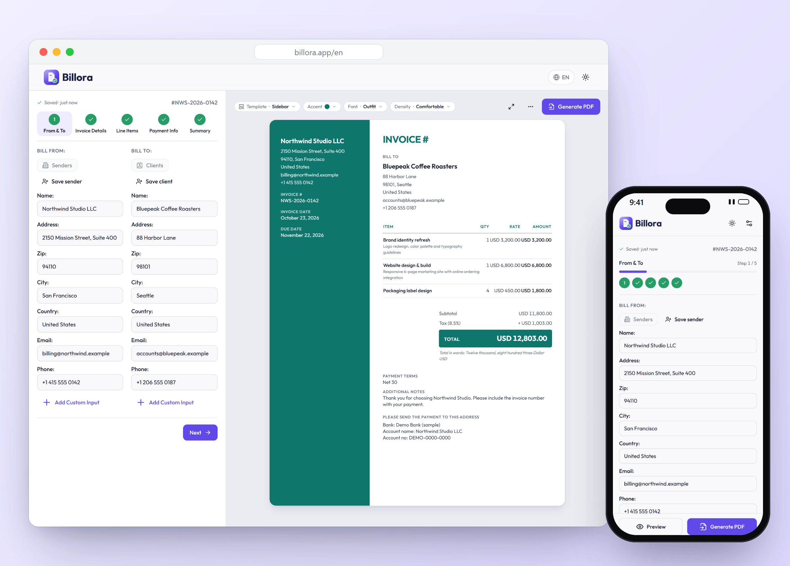
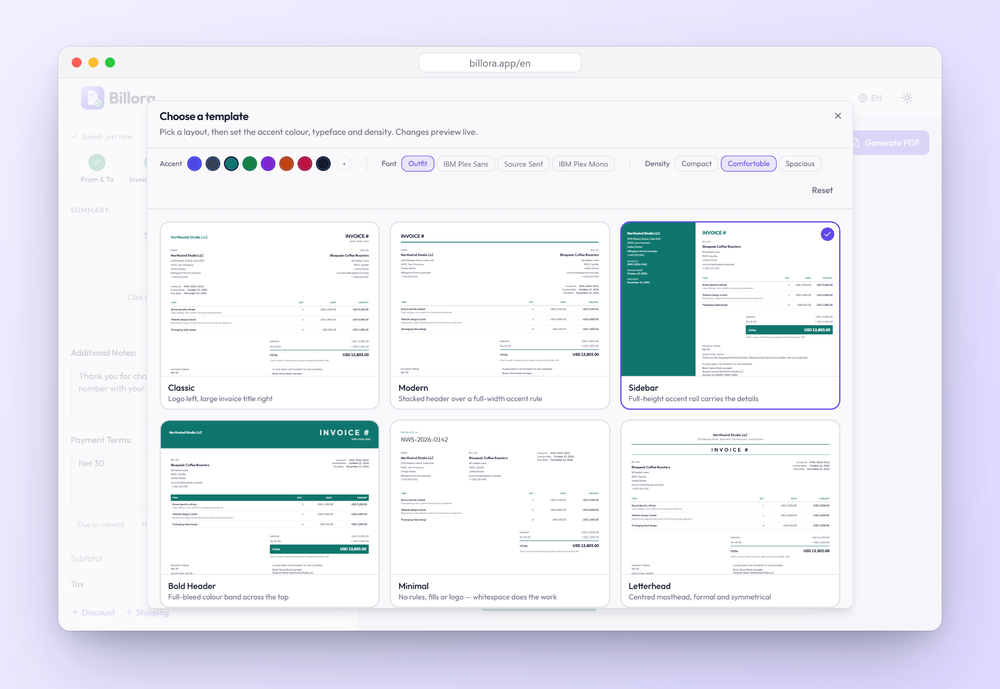
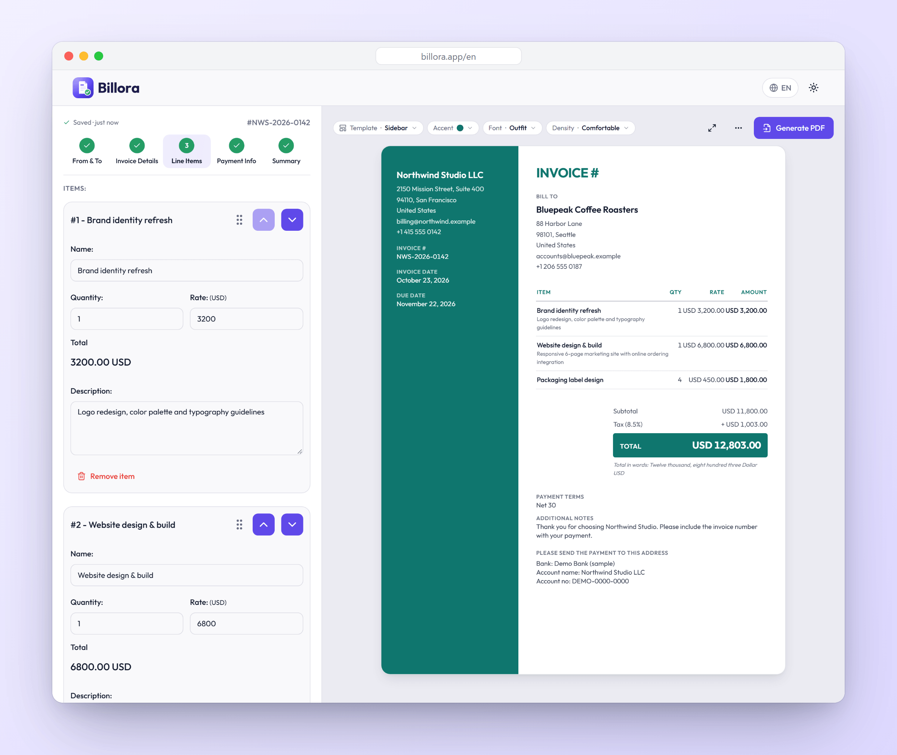
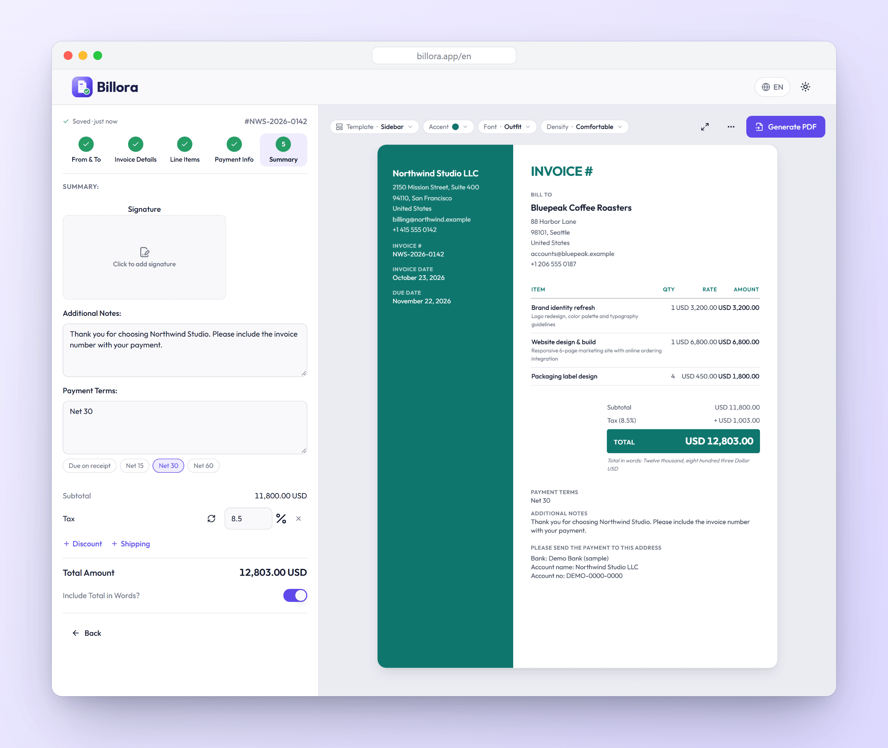
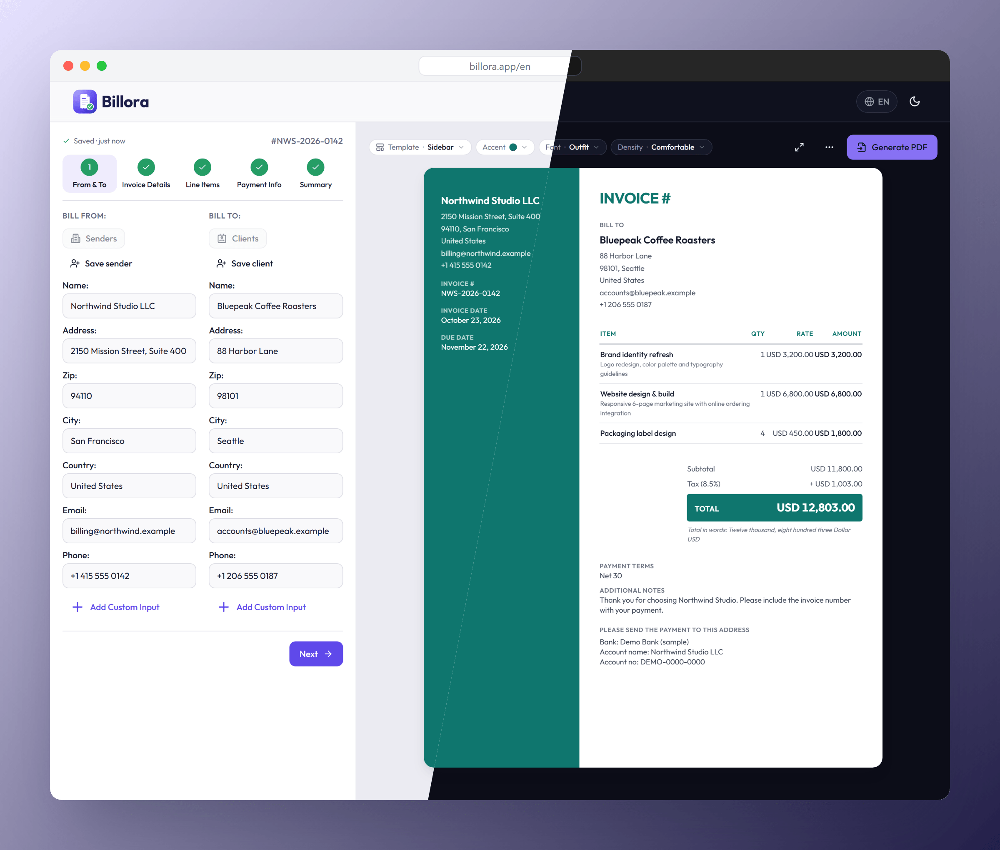
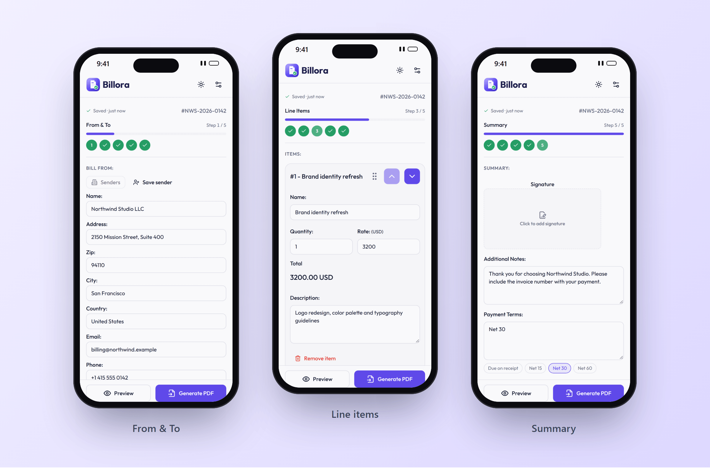
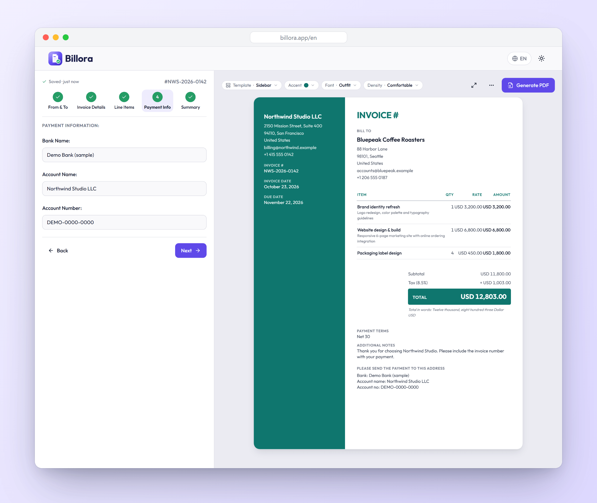
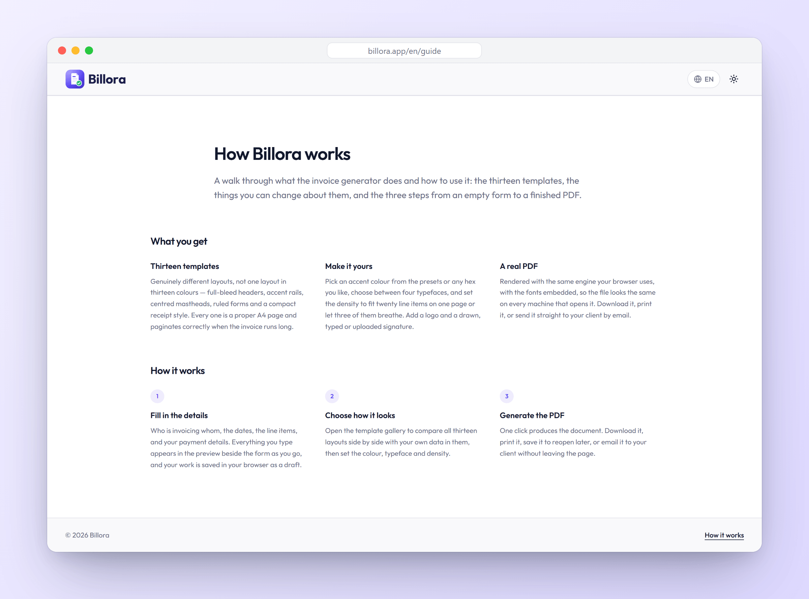
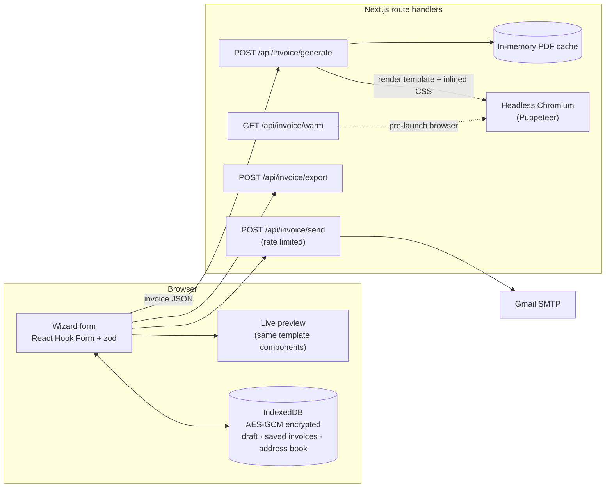

<div align="center">

# Billora

**A free invoice generator that runs in the browser: a guided form, thirteen templates and a real PDF. No account, no database.**


[Features](#features) · [Design](#design) · [Screenshots](#screenshots) · [Tech stack](#tech-stack) · [Getting started](#getting-started)

</div>

<br>

<picture>
  <source media="(prefers-color-scheme: dark)" srcset="readme/hero-dark.png">
  
</picture>

## Overview

Billora is for freelancers and small studios who need a clean invoice without signing up for an accounting product. The form and a live A4 preview sit side by side, so you see the document change as you type. When it looks right, the server renders a proper PDF with headless Chromium and embedded fonts, which you can download, print, save or email.

Everything you enter (draft, saved invoices, address book) stays in your browser and is encrypted at rest. Invoice data only leaves the machine for the moment it takes to render a PDF or send an email.

## Try the demo

There is no login. Start the app (see [Getting started](#getting-started)) and open http://localhost:3000.

To see a fully filled invoice straight away, open the **⋯** menu next to *Generate PDF*, choose **Load Invoice → Import JSON** and pick [`demo/sample-invoice.json`](demo/sample-invoice.json). It loads a three-line design-studio invoice (USD 11,800 subtotal, 8.5% tax, Net 30) on the Sidebar template. Every screenshot below uses that file.

## Features

### Thirteen templates, rendered with your data

Classic, Modern, Sidebar, Bold Header, Minimal, Letterhead, Compact, Two-Tone, Bordered, Left Rail, Statement, Corner and Column. The gallery previews every layout with your own invoice, and accent color (presets or any hex), four typefaces and three density settings apply to all of them.

<picture>
  <source media="(prefers-color-scheme: dark)" srcset="readme/templates-dark.png">
  
</picture>

### A five-step wizard with a live preview

From & To, Invoice Details, Line Items, Payment Info and Summary, each with a completion check. The current step is kept in the URL and survives a reload, and clicking a part of the preview jumps to the field behind it. Line items reorder by drag and drop.

<picture>
  <source media="(prefers-color-scheme: dark)" srcset="readme/line-items-dark.png">
  
</picture>

### Totals, terms and signature

Tax, discount and shipping as a percentage or a fixed amount, quick payment-term chips (Due on receipt, Net 15/30/60), total in words, and a signature that can be drawn, typed in a script font or uploaded.

<picture>
  <source media="(prefers-color-scheme: dark)" srcset="readme/summary-dark.png">
  
</picture>

**Also included**
- Server-rendered PDF with embedded fonts, cached in memory so re-downloading is instant. Download, print, preview in a new tab or email it to the client.
- Export the invoice as JSON, CSV or XML, and import JSON back.
- Autosaved draft, saved invoices and an address book of senders and clients, encrypted in IndexedDB.
- Interface and PDF in English, French, Italian and Spanish, with 170+ currencies.

## Design

- **Two panes, one document.** The form is a narrow rail on the left and the invoice is the hero on the right, rendered at true A4 proportions on a soft grey canvas, so the output always feels like paper.
- **Design system.** shadcn/ui on Radix primitives with Tailwind CSS variables; a violet brand color for actions and progress, and a separate accent color that belongs to the invoice, not the app.
- **Light and dark.** A theme toggle in the header (next-themes) switches the whole editor. The invoice preview keeps its own colors in both themes, because it is what gets printed.
- **Responsive.** On phones the preview moves behind a **Preview** button, the step bar becomes a compact progress row and the main actions sit in a bottom bar within thumb reach.
- **Feedback.** "Saved · just now" autosave status, completion checks per step, and inline validation messages from the same zod schema the server uses.
- **Accessibility.** Radix dialogs, menus and popovers with focus management and keyboard support; steps are buttons with descriptive labels ("Step 3: Line Items").

<p align="center"></p>

<picture>
  <source media="(prefers-color-scheme: dark)" srcset="readme/mobile-dark.png">
  
</picture>

## Screenshots

| | |
| --- | --- |
| <picture><source media="(prefers-color-scheme: dark)" srcset="readme/payment-dark.png"></picture><br>**Payment info.** Bank details printed on the invoice. | <picture><source media="(prefers-color-scheme: dark)" srcset="readme/guide-dark.png"></picture><br>**Guide.** A short walkthrough of what the generator does. |

All screenshots come from the running app: desktop at 1440×900 and mobile at 390×844, both at retina resolution. Images switch to dark versions when GitHub is in dark mode.

## Tech stack

| Layer | Technology | Why |
| --- | --- | --- |
| Framework | Next.js 15.3 (App Router, route handlers), React 18.2 | Static editor plus a few server endpoints for PDF, export and email |
| Language | TypeScript 5 | One `InvoiceSchema` type shared by the form, preview and API |
| UI | Tailwind CSS 3, shadcn/ui on Radix primitives, lucide-react, next-themes, dnd-kit | Accessible primitives, theming and drag-and-drop line items |
| Forms | React Hook Form 7, zod 3 | Fast forms with the same validation on client and server |
| i18n | next-intl 4 (locale-prefixed routes) | Translated interface and PDFs |
| PDF | Puppeteer 24 locally, puppeteer-core with `@sparticuz/chromium` on serverless | Pixel-identical PDFs from the same templates as the preview |
| Email | Nodemailer 6 with React Email templates | Send the PDF straight to the client |
| Export | `@json2csv/node`, `xml2js` | JSON, CSV and XML exports |
| Tests | Playwright 1.62 (desktop and mobile projects) | Covers both the UI and the real PDF output |
| Tooling | ESLint, Prettier, GitHub Actions, Docker | CI on every push and pull request |

## Architecture



**Key decisions**
- **No backend state.** There are no accounts and no database. The server only renders, exports and sends, and keeps nothing after the request. That makes the app free to host and removes a whole class of privacy questions.
- **One set of templates for preview and PDF.** The preview and the PDF use the same React layouts. For the PDF the server renders the template to HTML, inlines a prebuilt stylesheet (`lib/pdfStyles.generated.ts`, generated by `scripts/build-pdf-css.mjs` before every `dev` and `build`) and prints it with Chromium, so what you see is what you get.
- **Chromium where it runs best.** Locally and on a normal server the full `puppeteer` package is used. On Vercel, Netlify or Lambda the code switches to `puppeteer-core` with `@sparticuz/chromium`. A warm-up endpoint launches the browser before the first click, and identical invoices are served from a size-bounded in-memory cache.
- **Encrypted local storage.** The key is generated as non-extractable, so it cannot be copied out of the origin. This protects against someone reading the browser profile from disk. It does not protect against a script injected into the page, which would hold the same key handle.

## Engineering highlights

- **The server never trusts the client.** Every route reads the body through `parseJsonBody`, which caps its size (4 MB), parses it and validates it against the zod schema. Logos must be data URLs, the accent must be a hex color and fonts come from a fixed list.
- **Honest security notes in code.** `lib/secureStore.ts` documents exactly what the encryption defends against and what it doesn't, and measures the cost of each step (it dropped base64 after finding it cost 30× the encryption itself).
- **Bounded resources.** The PDF cache is size-bounded, the email rate limiter caps the number of tracked keys, and Chromium is launched once and reused.
- **Tested where it matters.** Playwright runs against a production build in desktop and mobile viewports and checks real PDF output: every template fits one A4 page, logos reach the PDF, accented locales render with the right fonts, and concurrent generations work.

```ts
// lib/server/validateRequest.ts
export async function parseJsonBody<S extends ZodTypeAny>(
    req: NextRequest,
    schema: S,
    maxBytes: number = MAX_JSON_BODY_BYTES
): Promise<ValidationResult<z.infer<S>>> {
    // Trust the declared length only to reject early; the real check is below.
    const declaredLength = Number(req.headers.get("content-length") ?? "0");
    if (declaredLength > maxBytes) {
        return badRequest("Request body is too large", 413);
    }

    let raw: string;
    try {
        raw = await req.text();
    } catch {
        return badRequest("Could not read request body");
    }
    if (Buffer.byteLength(raw, "utf8") > maxBytes) {
        return badRequest("Request body is too large", 413);
    }
    // ... JSON.parse, then schema.safeParse
```

```ts
// lib/secureStore.ts
const iv = window.crypto.getRandomValues(new Uint8Array(IV_BYTES));
const ciphertext = await window.crypto.subtle.encrypt(
    { name: "AES-GCM", iv },
    vault.key, // generated with extractable: false
    new TextEncoder().encode(JSON.stringify(value))
);

const payload = new Uint8Array(IV_BYTES + ciphertext.byteLength);
payload.set(iv, 0);
payload.set(new Uint8Array(ciphertext), IV_BYTES);
await idbPut(vault.db, VALUE_STORE, storageKey, payload);
```

## Getting started

**Prerequisites:** Node.js 20 or newer and npm. No Docker or database needed. `npm install` downloads Chromium for Puppeteer, so the first install takes a few minutes.

```bash
git clone <your-fork-url> billora
cd billora
npm install
```

```bash
npm run dev
```

Open http://localhost:3000. You are redirected to `/en` and see the empty editor; `/fr`, `/it` and `/es` work too. Load `demo/sample-invoice.json` to see a complete invoice.

<details>
<summary><b>Environment variables</b></summary>

All optional. Put them in `.env.local`.

| Name | Required | Description |
| --- | --- | --- |
| `NEXT_PUBLIC_SITE_URL` | For production | Canonical origin used in metadata, sitemap, robots and JSON-LD. Defaults to `http://localhost:3000`. |
| `NODEMAILER_EMAIL` | For email | Gmail address that sends invoices. |
| `NODEMAILER_PW` | For email | A Gmail App Password (requires 2-Step Verification), not the account password. |
| `GOOGLE_SC_VERIFICATION` | No | Google Search Console verification token. |

Without the email variables everything works except **Send to mail**, which returns an error.

</details>

<details>
<summary><b>Scripts</b></summary>

| Script | What it does |
| --- | --- |
| `npm run dev` | Development server. Rebuilds the PDF stylesheet first. |
| `npm run build` / `npm start` | Production build and server. |
| `npm run build:pdf-css` | Rebuild only the stylesheet inlined into PDFs. |
| `npm run lint` | ESLint. |
| `npm run format` / `format:check` | Prettier. |
| `npm run test:e2e` | Playwright tests against a production build. |
| `npm run test:e2e:ui` | The same tests in Playwright's UI mode. |
| `npm run analyze` | Production build with the bundle analyzer. |
| `npx tsc --noEmit` | Typecheck. |

</details>

<details>
<summary><b>Project structure</b></summary>

```
app/
  [locale]/             editor page, guide page, OG image, locale layout
  api/invoice/          generate, send, export, warm route handlers
  components/
    invoice/            wizard form, step sections, preview and action bar
    templates/
      invoice-pdf/      the 13 invoice layouts (shared by preview and PDF)
      email/            React Email template for sending PDFs
    modals/             load/save, export, signature, email, new-invoice
contexts/               invoice, wizard, charges, signature, theme and translation contexts
services/invoice/
  server/               Chromium launcher, PDF generation and cache, export, email
  client/               client-side calls to the API
lib/                    zod schemas, secure storage, wizard steps, SEO, helpers
lib/server/             request validation and rate limiting
i18n/locales/           en, fr, it, es messages
scripts/build-pdf-css.mjs   compiles the stylesheet inlined into PDFs
demo/sample-invoice.json    sample invoice for import
e2e/smoke.spec.ts       Playwright suite
```

</details>

## Testing & quality

```bash
npx playwright install --with-deps chromium
npm run test:e2e
npx tsc --noEmit
npm run lint
```

The Playwright suite builds and serves the production bundle and runs in a desktop and a mobile viewport. It covers rendering without console errors, draft persistence, the wizard and its URL state, the template gallery, the desktop pane layout and narrow-rail overflow, and the API: real PDF output, caching, concurrent generations, every template fitting one A4 page, logos reaching the PDF, font coverage for accented locales, SEO metadata, sitemap and manifest. CI (`.github/workflows/ci.yml`) runs typecheck, lint and the e2e suite on every push and pull request.

## Deployment

- **Vercel or Netlify:** works as is. The serverless Chromium package is picked up automatically. Set `NEXT_PUBLIC_SITE_URL`, and the two `NODEMAILER_*` variables if you want email. PDF generation is CPU-heavy, so give the function enough memory.
- **Docker:** a multi-stage `Dockerfile` is included. It prunes dev dependencies, which removes the full `puppeteer` package the non-serverless path imports, so PDF generation needs a fix (point `puppeteer-core` at the Alpine Chromium the image installs) before the image is usable.
- The email rate limiter is in memory, so on multiple instances each one counts separately. Use a shared store if email abuse matters.

## Roadmap

- Make the Docker image generate PDFs with the system Chromium.
- Export CSV with one row per line item.
- A provider-agnostic SMTP transport instead of Gmail only, and a clear 503 when email is not configured.
- Bundle the currency list locally instead of fetching it at runtime.